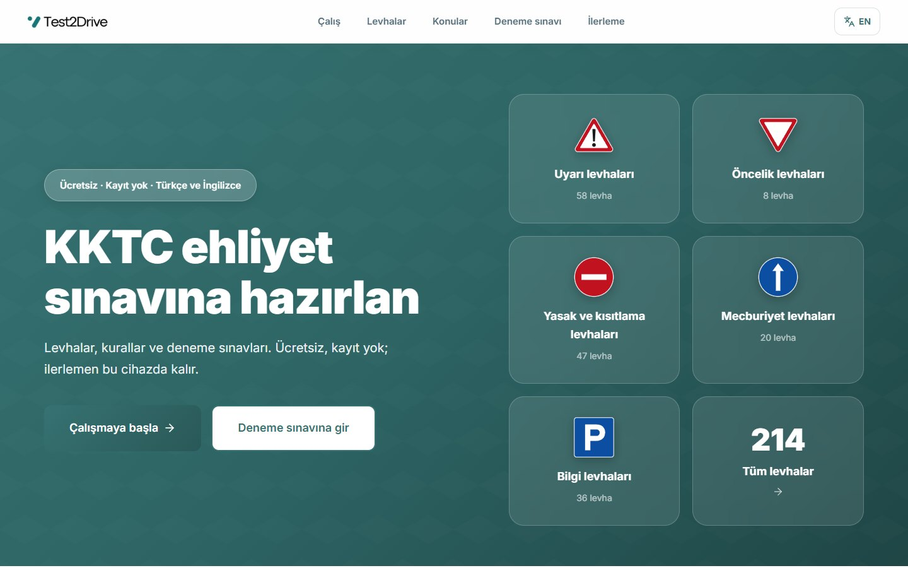
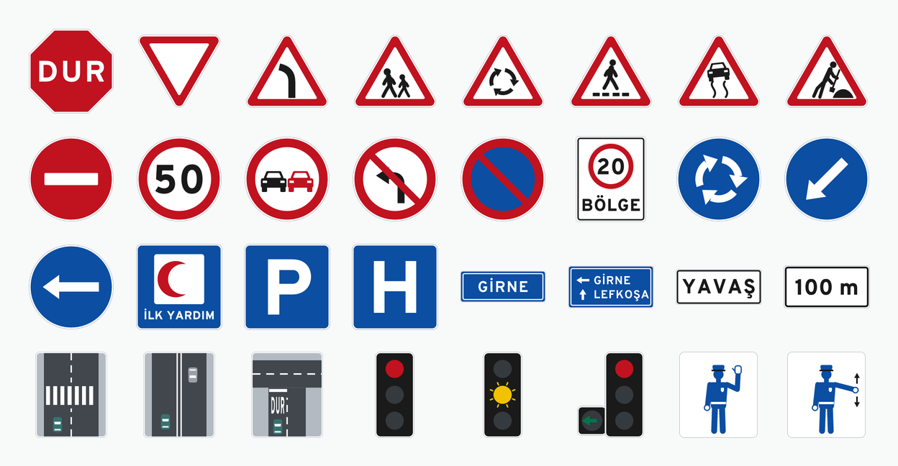
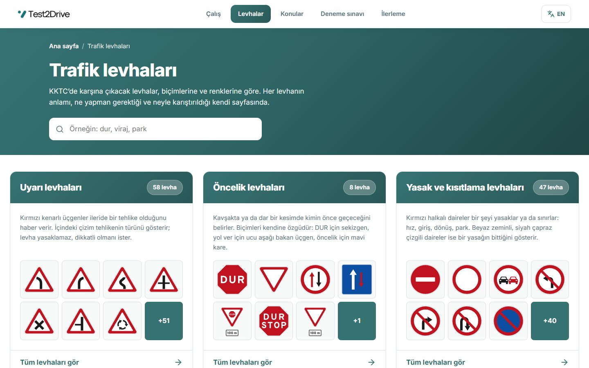
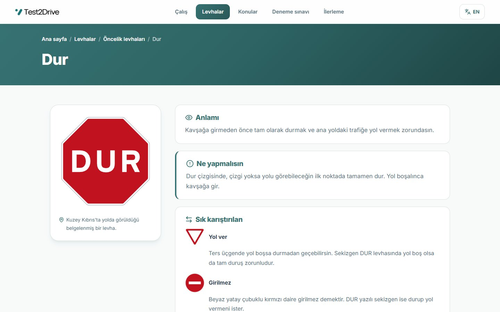
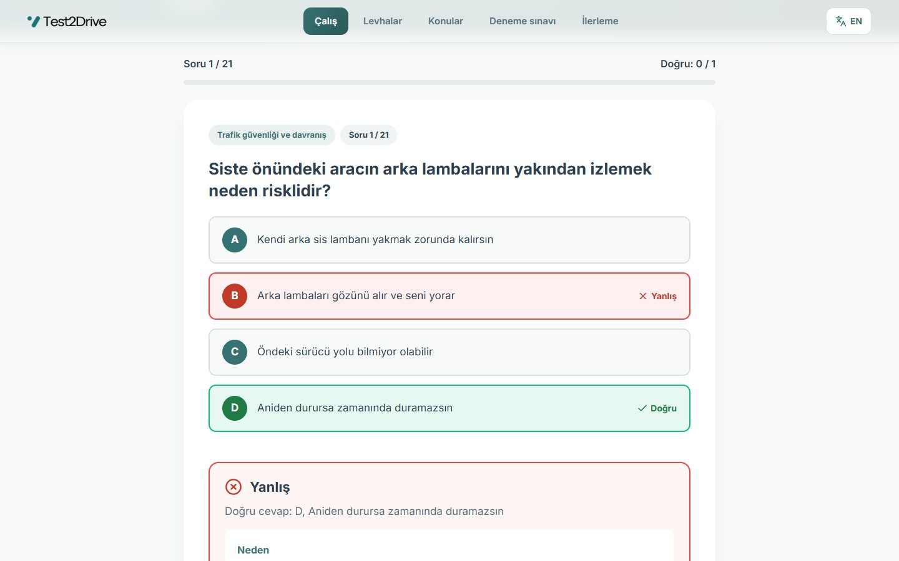
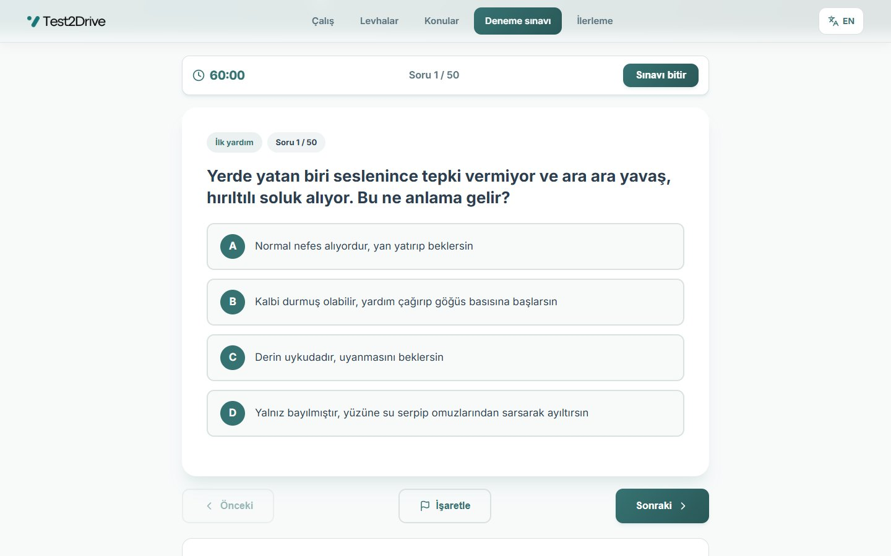
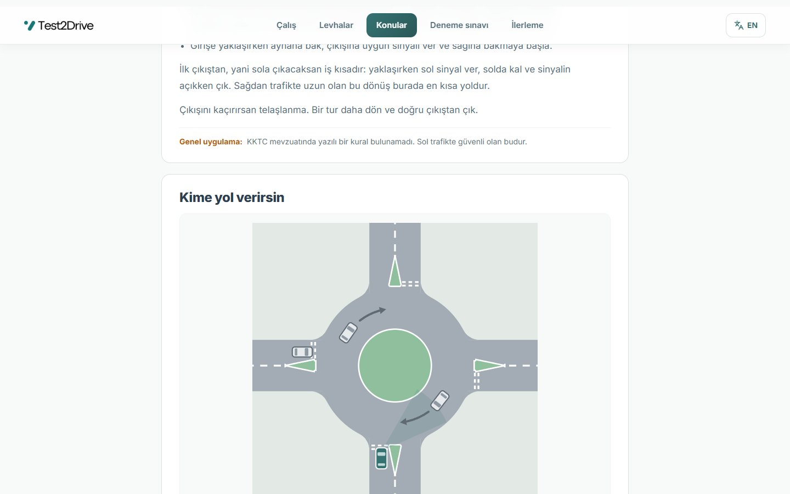
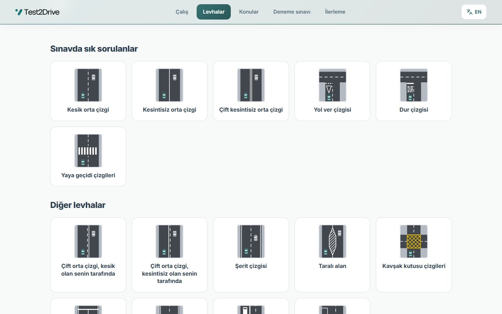
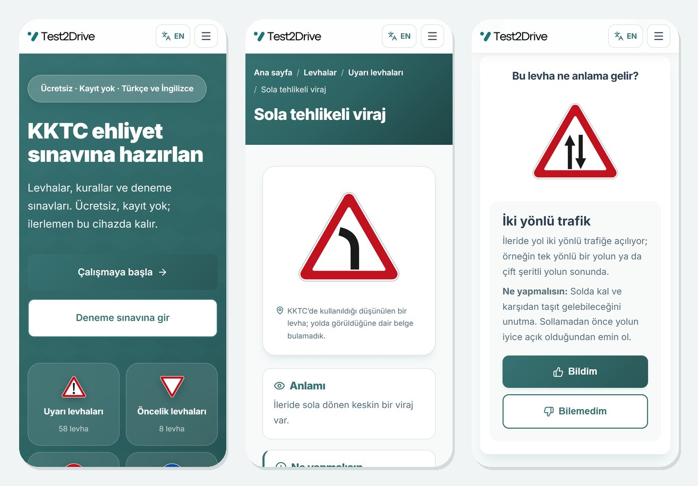
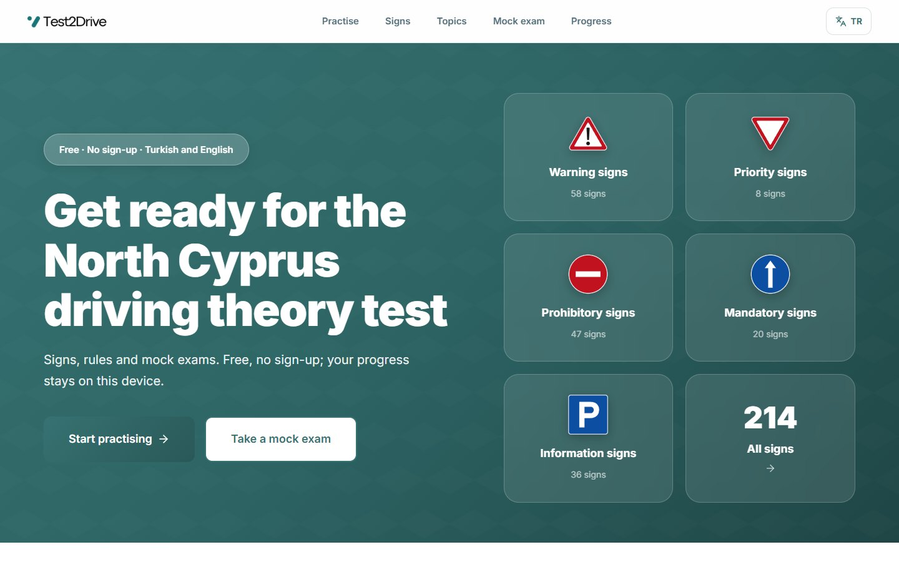

  <picture>
    <source media="(prefers-color-scheme: dark)" srcset="docs/readme/logo-dark.png" />
    
  </picture>

<h3 align="center">KKTC ehliyet sınavına ücretsiz hazırlık</h3>

  Levhalar, kurallar ve deneme sınavları. Türkçe ve İngilizce. Kayıt yok, reklam yok; ilerlemen yalnız senin cihazında kalır.

  

## Test2Drive nedir

Kuzey Kıbrıs'ta ehliyet almak isteyen herkes için bir çalışma sitesi. Levhaları öğrenirsin, eksiklerini her gün biraz tekrar edersin, sınava girmeden önce kendini denersin.

Site, KKTC'nin kendi kurallarına göre hazırlandı. Soldan trafik, saat yönünde dönülen çemberler, KKTC'nin ehliyet sınıfları ve Türkçe levha yazıları her yerde doğru. Her kuralın altında hangi yasaya dayandığı yazar; yazılı bir kural bulunamadıysa bu da açıkça söylenir.

## Levhalar

KKTC yollarında karşına çıkacak 214 levha, çizgi ve işaret. Hepsi bu proje için baştan çizildi ve herkesin serbestçe kullanabilmesi için kamuya açık bırakıldı.

  

Uyarı, öncelik, yasak, mecburiyet ve bilgi levhalarının yanında ek levhalar, yol çizgileri, trafik ışıkları ve polis el işaretleri de var. Levhalar biçimlerine ve renklerine göre gruplanmış; aradığını adıyla da bulabilirsin.

  

Her levhanın kendi sayfası var: ne anlama geldiği, onu görünce ne yapman gerektiği ve hangi levhayla sık karıştırıldığı. Sayfanın sonunda o levhayla hemen bir soru çözebilirsin.

  

## Çalış

**Bugünkü tekrar** her gün yaklaşık 20 soru getirir. Unutmaya başladığın soruları zamanında geri getirir, yanlış yaptıklarını Hatalarım'da toplar. Bir soruyu farklı günlerde iki kez doğru bilince listeden çıkar. Tahminle doğru bildiysen "emin değilim" dersin ve soru yakında tekrar sorulur.

Her cevaptan sonra nedenini ve kaynağını görürsün. Bir soruda hata görürsen tek tıkla bildirebilirsin.

  

**Levha sınavı provası**, bugünkü sözlü sınava en yakın çalışma biçimi. Levhayı görürsün, anlamını yüksek sesle söylersin, sonra cevabı açıp bilip bilmediğini işaretlersin.

**Senaryolar** levhaları ve kuralları yolda karşına çıktıkları gibi sorar: okul önünde çocuklar, arkadan gelen ambulans, yağmurda fren, çembere giriş.

## Deneme sınavı

Otomobil, motosiklet ve ağır vasıta için ayrı ayrı. 2017 yönetmeliğinde tanımlanan yazılı sınav biçimini kullanır: otomobil ve motosiklet için 50 soru, 40 doğru, 60 dakika. Bu yazılı sınav henüz uygulanmıyor ve bugünkü teori sınavı sözlü. Deneme sınavı yine de bilgini ölçmenin iyi bir yolu.

Cevaplarının doğru olup olmadığını sınavı bitirince, konu konu görürsün. Yanlışların Hatalarım'a eklenir. Yarım bıraktığın sınav, sayfayı kapatsan da kaldığı yerden devam eder.

  

## Konular

Sınavın kapsadığı her konu için birkaç dakikada okunacak kısa bir sayfa: öncelik kuralları, hız ve takip mesafesi, sollama, park, alkol ve yorgunluk, ilk yardım, motosiklet, ağır vasıtalar ve daha fazlası. Toplam 19 konu.

Sağdan trafiğe alışkın sürücüler için **çember rehberi**, KKTC'de çembere nasıl girilip çıkıldığını çizimlerle anlatır.

  

Yol çizgileri, trafik ışıkları ve polis işaretleri de kendi sayfalarında.

  

## Telefonda da aynı

Site telefona göre tasarlandı. Ana ekrana ekleyebilirsin; internet kesildiğinde de çalışmaya devam eder.

  

## Türkçe ve İngilizce

Bütün site iki dilde. KKTC'de okuyan uluslararası öğrenciler için İngilizce sayfalarda her levhanın Türkçe adı da yazar, çünkü yolda ve sınavda Türkçe kullanılır. Soldan trafik ve ehliyet çevirme için ayrı rehber sayfaları var.

  

## Neden güvenebilirsin

- Her kural, soru ve açıklama üç etiketten birini taşır: **yasada yazılı** (hangi yasa ve madde olduğu yazar), **ikincil kaynak** ya da **genel uygulama** (KKTC'de yazılı bir kural bulunamadı, sol trafikte güvenli olan budur).
- Kaynaklar arasında çelişen bilgi yayınlanmaz.
- Kaynakların tam listesi ve içeriğin son kontrol tarihi sitede yazar.
- Test2Drive resmi bir kurum değildir ve gerçek sınavın sonucunu garanti etmez.

## Gizlilik

Hesap açmazsın. Cevapların hiçbir sunucuya gitmez; ilerlemen yalnız kullandığın tarayıcıda saklanır. Çerez ve analitik yoktur. İlerlemeni bir dosyaya aktarıp başka bir cihazda açabilir ya da istediğin an silebilirsin.

## Hata mı gördün

Bir soruda, levhada ya da kuralda hata görürsen [buradan bildirebilirsin](https://github.com/Asilturkmen/TRAF101/issues/new). Sitedeki her sorunun altında da bir "Bu soruda hata var" bağlantısı var.

## Hakkında

Test2Drive, Doğu Akdeniz Üniversitesi'nde (DAÜ) TRAF101 Trafik Güvenliği dersi için başlayan bir projedir. Siteyi [Asil Türkmen](https://asilturkmen.com) ve [Arda Günsüren](https://www.ardagunsuren.com) birlikte hazırladı. Dersin öğretim üyesi Doç. Dr. Metin Kurt'a teşekkür ederiz.

Levha çizimleri herkesin serbestçe kullanabilmesi için kamuya açık bırakılmıştır (CC0).

Geliştiriciler için: [docs/DEVELOPMENT.md](docs/DEVELOPMENT.md)
